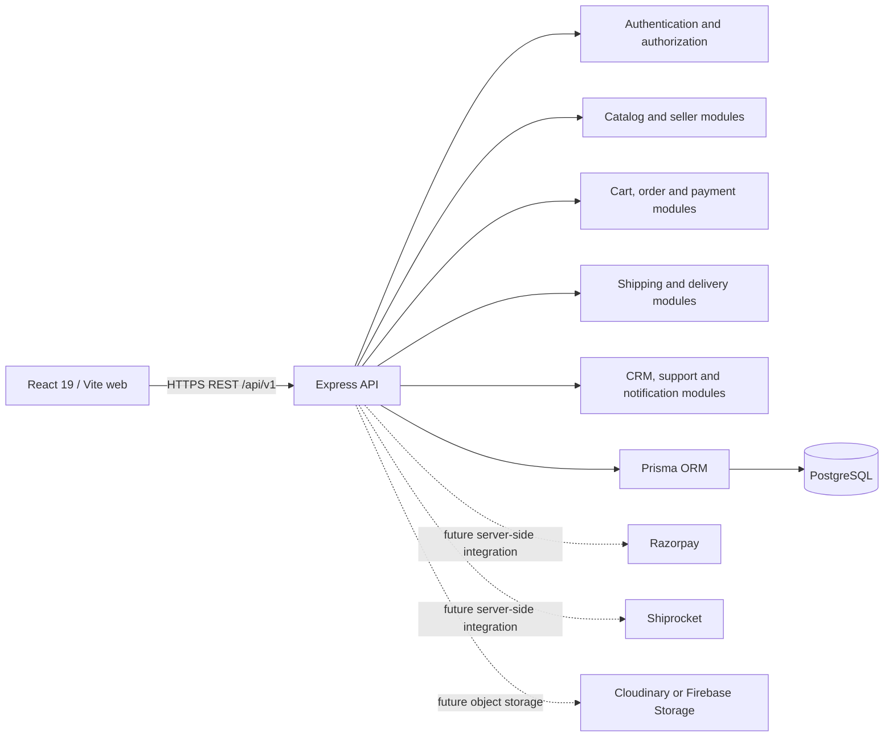

# Poeage E-com system architecture

## Phase 1 baseline

Poeage E-com is organized as a workspace monorepo. The existing React storefront is preserved in `apps/web`; `apps/api` is the Node.js/Express REST API; and `prisma/` owns the PostgreSQL data model, migrations, and development seed.

The initial deployment target is a modular monolith. Business domains remain isolated by API module so high-traffic components can be separated later based on actual operational needs. Payment gateways, shipping providers, notification channels, and object storage are accessed only from the backend.

## Workspace commands

- `npm run dev:web`: Vite storefront on port 5173.
- `npm run dev:api`: Express API on port 4000.
- `npm run build`: production web build.
- `npm test`: API unit/integration tests.
- `npm run db:generate`: generate Prisma Client.
- `npm run db:migrate`: create/apply a local development migration.
- `npm run db:deploy`: apply checked-in migrations in a deployment environment.
- `npm run db:seed`: idempotently seed development roles, permissions, and categories; refuses to run unless `NODE_ENV=development`.

## Authentication decision

The planned authentication implementation is backend-managed JWT sessions: short-lived access credentials, rotating refresh credentials in `HttpOnly`, `Secure`, `SameSite` cookies, and Argon2id password hashes. External identity providers can be added later without putting authorization decisions in the browser. Every API action must enforce permissions and record ownership on the server. No authentication is implemented in Phase 1.

## Marketplace order model

A customer order is the payment and customer-facing aggregate. Checkout must split its line items into seller-specific `SellerOrder` records in one database transaction. Seller fulfillment, delivery shipments, commission calculation, and settlement line items attach to the seller order. Inventory is reserved atomically; the server calculates totals from current catalog prices and never trusts client-supplied prices or payment status.

## Frontend transition

The existing storefront was moved without redesign from CRA to Vite. Existing routes and components remain in `apps/web/src`. Browser-local cart, customer, seller, and order data remains a visual prototype and must not be used for real transactions. API integration will replace this prototype module-by-module in later phases.
