# Poeage E-com database design

The Prisma schema is the source of truth at [`../prisma/schema.prisma`](../prisma/schema.prisma). PostgreSQL foreign keys, unique constraints, indexes, enum-backed lifecycle states, and timestamps are defined in the schema. The initial migration is generated from this schema and checked in under `prisma/migrations/`.

```mermaid
erDiagram
  USERS ||--o{ USER_ROLES : has
  ROLES ||--o{ USER_ROLES : grants
  ROLES ||--o{ ROLE_PERMISSIONS : contains
  PERMISSIONS ||--o{ ROLE_PERMISSIONS : assigned
  USERS ||--o| CUSTOMER_PROFILES : has
  USERS ||--o| SELLER_PROFILES : owns
  SELLER_PROFILES ||--o{ SELLER_DOCUMENTS : submits
  SELLER_PROFILES ||--o{ SELLER_BANK_ACCOUNTS : registers
  USERS ||--o{ SELLER_APPLICATIONS : applies
  CATEGORIES ||--o{ PRODUCTS : classifies
  SELLER_PROFILES ||--o{ PRODUCTS : lists
  PRODUCTS ||--o{ PRODUCT_VARIANTS : offers
  PRODUCTS ||--o{ PRODUCT_IMAGES : displays
  PRODUCT_VARIANTS ||--o| INVENTORY : stocks
  USERS ||--o{ ADDRESSES : saves
  USERS ||--o| CARTS : owns
  CARTS ||--o{ CART_ITEMS : contains
  PRODUCT_VARIANTS ||--o{ CART_ITEMS : selected
  USERS ||--o| WISHLISTS : owns
  WISHLISTS ||--o{ WISHLIST_ITEMS : contains
  PRODUCTS ||--o{ WISHLIST_ITEMS : saved
  USERS ||--o{ ORDERS : places
  ORDERS ||--|{ SELLER_ORDERS : splits_into
  SELLER_PROFILES ||--o{ SELLER_ORDERS : fulfills
  SELLER_ORDERS ||--|{ ORDER_ITEMS : contains
  ORDERS ||--o{ PAYMENTS : attempts
  PAYMENTS ||--o{ REFUNDS : refunds
  SELLER_ORDERS ||--o| SHIPMENTS : ships
  SHIPMENTS ||--o{ SHIPMENT_EVENTS : tracks
  DELIVERY_PARTNERS ||--o{ SHIPMENTS : handles
  SELLER_ORDERS ||--o| COMMISSIONS : incurs
  SELLER_PROFILES ||--o{ SELLER_SETTLEMENTS : receives
  SELLER_SETTLEMENTS ||--o{ SELLER_SETTLEMENT_ITEMS : includes
  USERS ||--o{ REVIEWS : writes
  PRODUCTS ||--o{ REVIEWS : receives
  COUPONS ||--o{ COUPON_REDEMPTIONS : redeemed
  USERS ||--o{ NOTIFICATIONS : receives
  USERS ||--o{ CUSTOMER_CRM_NOTES : subject
  USERS ||--o{ SUPPORT_TICKETS : opens
  USERS ||--o{ AUDIT_LOGS : acts
```

## Data integrity and sensitive data

- User identity is unique by email and optional phone. Roles and permissions use normalized join tables.
- Seller-owned catalog and fulfillment records carry a seller foreign key. Application code must also enforce seller ownership in every query and mutation.
- Order item names, SKU, product data, price, and shipping-address details are snapshots so later catalog/address edits cannot rewrite order history.
- Monetary fields use fixed-precision `Decimal`, never floating-point storage.
- Provider webhook event IDs and payment/refund identifiers are unique to support idempotent integration processing.
- Bank account details are represented by a provider token and last four digits; do not store raw account credentials or card data.
- KYC and image storage uses storage keys, not public secrets or local filesystem paths.
- `AuditLog` records actor, action, entity, request identifier, IP, metadata, and timestamp.
- Production checkout, inventory reservation, payment transitions, refunds, and settlements must use database transactions and row-level conflict handling.

## Development seed

The seed creates the four platform roles, baseline permissions, role-permission assignments, and product categories. It creates no users, credentials, sellers, inventory, customer records, or payment data. The seed explicitly refuses non-development environments.
